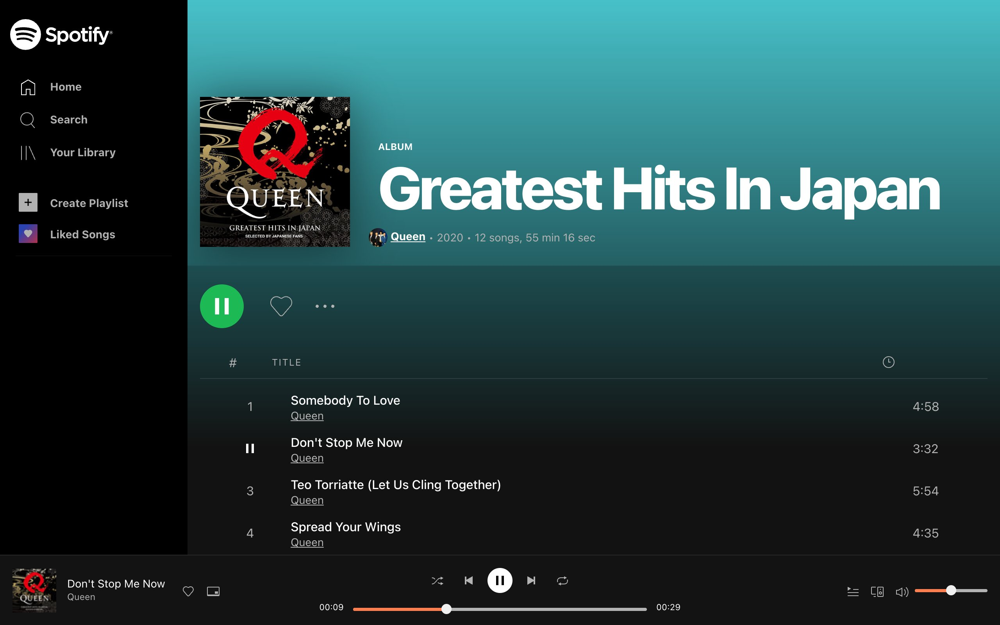
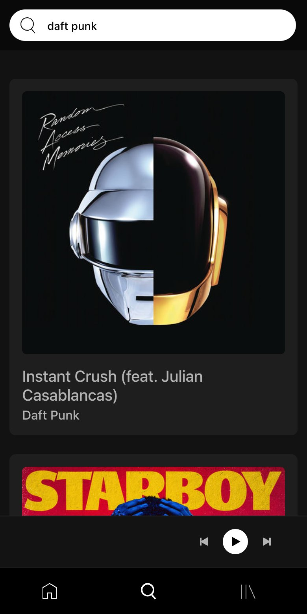
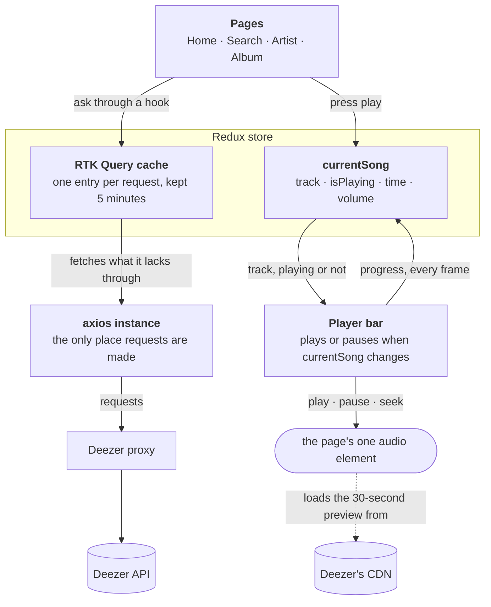

# Nandotify

A Spotify clone you can listen to. Browse the day's recommendations, search Deezer's catalogue, open an artist or an album, and play a 30-second preview of any track from a player bar that keeps going while you move around the site. This is the front-end only: the catalogue and the previews come from the [Deezer API](https://developers.deezer.com/api) through a small proxy.

React 19 · Redux Toolkit 2 with RTK Query · React Router 7 · React-Bootstrap · Axios · Vite 8 · Vitest with Testing Library and MSW

<p>
  
  
</p>

## Try it

The demo runs at [nandotify.vercel.app](https://nandotify.vercel.app).

- **Play something.** Hover a card on the home page and press its play button. The bar at the bottom shows the track, with links to its album and its artist.
- **Follow a link.** A cover or a title opens the album; an artist's name opens the artist, with their most popular tracks and their albums. The track keeps playing.
- **Switch tracks.** Press play on any row of an album or of an artist's popular tracks, or the large green button to start from the top. A different track takes over straight away.
- **Search.** Type an artist or a song. The results update when you pause typing.
- **Use the bar.** Play and pause, drag the progress bar to seek, skip five seconds back or forward with the two arrow buttons, and change the volume. On a phone the bar keeps play, pause and the skip buttons; the progress bar and the volume appear from tablet width up.

**What is not there.** Previews are 30 seconds long because that is what Deezer provides. Shuffle, repeat, like, follow and the playlist controls are part of the layout but do nothing yet, and Your Library is a placeholder.

## Engineering decisions

Each with its reason and what it costs.

- **Playback follows the store.** One effect in the player watches two values, the loaded track and whether it should be playing, and calls `play()` or `pause()` on the page's single `<audio>` element. Every play button elsewhere only says which track and whether it should play, through one shared function. Cost: the element's progress is copied back into the store on every animation frame, about sixty updates a second while a track plays.
- **Never more than one progress loop.** Starting playback cancels the running loop before it starts another, and the player cancels its loop if it unmounts. Before this, every change of track left loops behind: seven were running after three changes, and they kept running while paused.
- **Search waits, and can neither show stale results nor hang.** A request goes out 400ms after the last keystroke. The page only shows the answer to the query it is currently asking about, so a slow response to an earlier query can never replace newer results, and a failed request shows a message instead of a spinner that never ends. Cost: results trail the typing by under half a second, and an earlier request that is no longer wanted still runs to completion instead of being cancelled.
- **Server data is cached by request, not held in one slot per page.** Every page asks for its data through an RTK Query hook, and each answer is stored under the request that produced it after the last component using it has gone: five minutes for a page or the home list, one minute for a search. Going back to an artist, an album or a search already made shows it at once and sends nothing. The artist page still asks for three things separately and at the same time, so it fills in as answers arrive. The store is deliberately not normalized: nothing here edits a track, an album or an artist, so two copies of one can never disagree. Cost: about 15 kB more JavaScript (gzipped), and a page reopened within five minutes can be that much out of date, which is fine for a catalogue.
- **The player is given one track shape.** Deezer returns a different set of fields for a track depending on the endpoint: a track inside an album does not carry its album, a search result does. Every play button passes its track through one function that reduces it to the seven fields the player uses, so each page decides whether "its" track is the one loaded by comparing ids. Cost: a field the player needs later has to be added in that function first.
- **Tests check what was playing, not what the store says.** A playing interface over a silent audio element is the failure worth catching, so the player tests record which file the element had when `play()` was called. Each regression test was checked by breaking the code and watching it fail. Cost: jsdom cannot play audio, so real playback is only exercised in a browser.
- **Links to a page work when opened directly.** The site is a single page with client-side routes, so `vercel.json` rewrites every path to it. Cost: an address that matches no route shows the frame of the site with nothing in it, not a "not found" page.

## Architecture



Read it as two columns. On the left, a page asks for its data through a hook; the cache answers from what it holds, and fetches what it lacks through the one axios instance. Search works the same way as the other pages. On the right, pressing play anywhere only changes `currentSong`; the player bar reacts to that and drives the audio element.

The code is in `src/`: `Components/` (each in its own folder with its stylesheet), `redux/api/` (the endpoints and their cache), `redux/slices/` (the player's state), `backend/axios.js` (the one place requests are made from), `utils/` and `tests/`.

## Quick start

You need [Node.js](https://nodejs.org/) 22 (22.13 or newer), 24 or 26.

```sh
npm install
cp .env.example .env    # then fill it in
npm run dev             # http://localhost:3000
```

### Environment variable

| Variable           | What it is                                                                                                                                                              |
| ------------------ | ----------------------------------------------------------------------------------------------------------------------------------------------------------------------- |
| `VITE_BACKEND_URL` | The base URL of a backend that proxies the Deezer API. The app calls `/search`, `/artist/:id`, `/artist/:id/top`, `/artist/:id/albums` and `/album/:id` on it. |

Vite reads it when it builds, so a deployment needs it set where the build runs. On Vercel that means the project's settings, for Production and for Preview.

### Scripts

| Command           | What it does                           |
| ----------------- | -------------------------------------- |
| `npm run dev`     | Dev server (`npm start` does the same) |
| `npm run build`   | Production build into `dist/`          |
| `npm run preview` | Serves the production build locally    |
| `npm test`        | Runs the test suite once               |
| `npm run lint`    | Runs ESLint over `src/`                |

## Testing

```sh
npm test
```

The suite runs with Vitest, Testing Library and MSW in jsdom: 53 tests over the home page, search, the data layer and playback. MSW answers every request at the network layer and fails a test that makes one it did not expect, so nothing reaches the real API and no `.env` is needed. It covers:

- **Home:** the loading and error states.
- **Search:** the debounce, encoding, a late response to an earlier query, a repeated query answered from the cache, error states, and recovery without older results coming back.
- **Data layer:** going back to an artist or an album sends no request, moving from one artist or album to another never shows the previous one's content, how long an unused result is kept, and a Deezer error or an empty body inside a successful response shows the error state.
- **Player:** play and pause, changing track while one is playing, the end of a track, the single progress loop, the progress bar's fill, the play buttons of the artist and album pages, and the one track shape from every page.

## About

Nandotify began in 2021 as an exercise in the Full Stack Master Camp at Strive School, and was my first real project. Later in the programme I started this repository and built it again from scratch, with a much better understanding of the tools; getting properly comfortable with Redux and Redux Toolkit was one of the goals.

In November 2026 it was brought up to date without changing how it looks: Create React App to Vite, React 17 to 19, Redux Toolkit 1 to 2, React Router 6 to 7, a test suite and a lint gate where there were none, and `npm audit` from 96 findings to 0. The pages' data then moved from hand-written slices to RTK Query.

It is a study project and is not affiliated with Spotify or Deezer.

[Hernando Crespo](https://hernando-crespo.vercel.app/) · [the live demo](https://nandotify.vercel.app)
