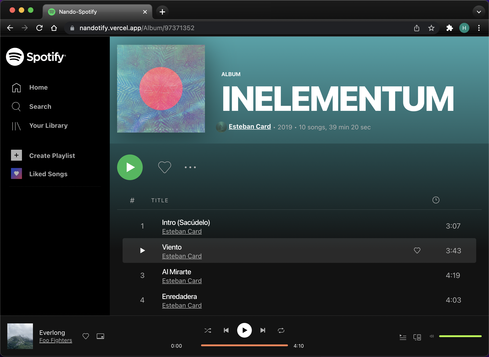
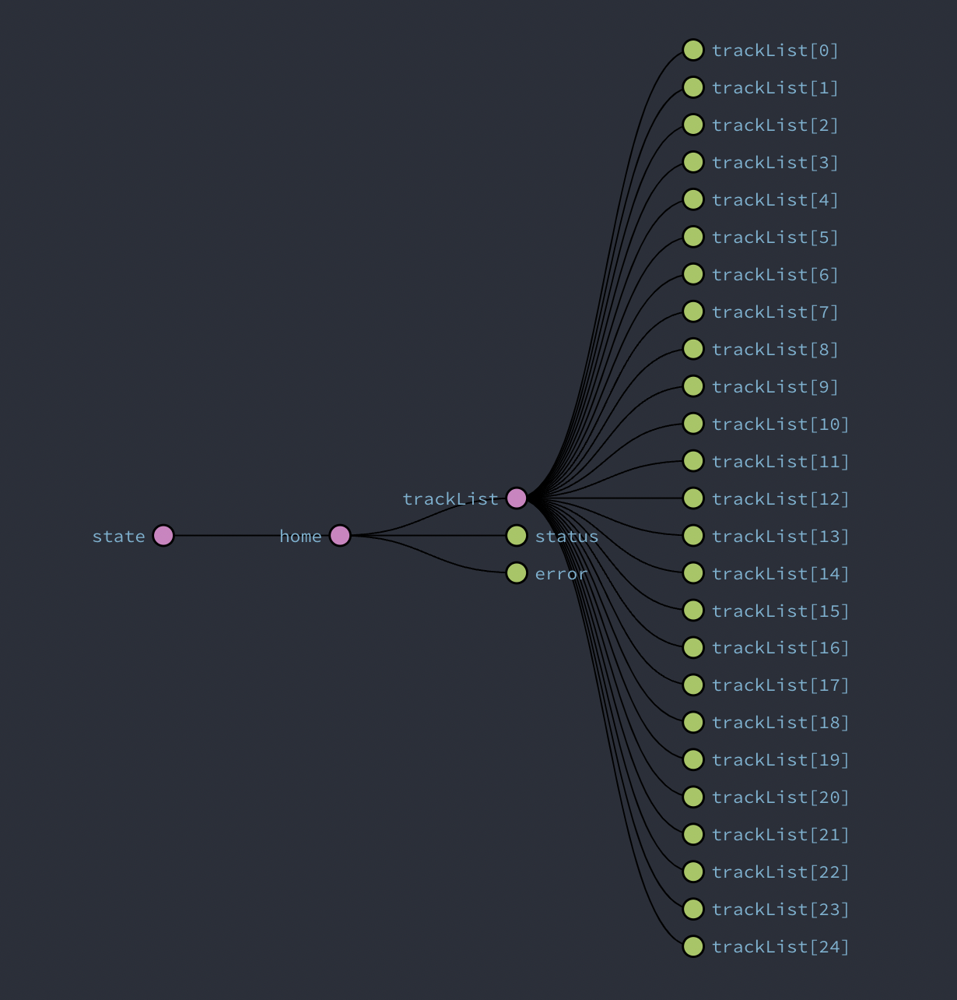
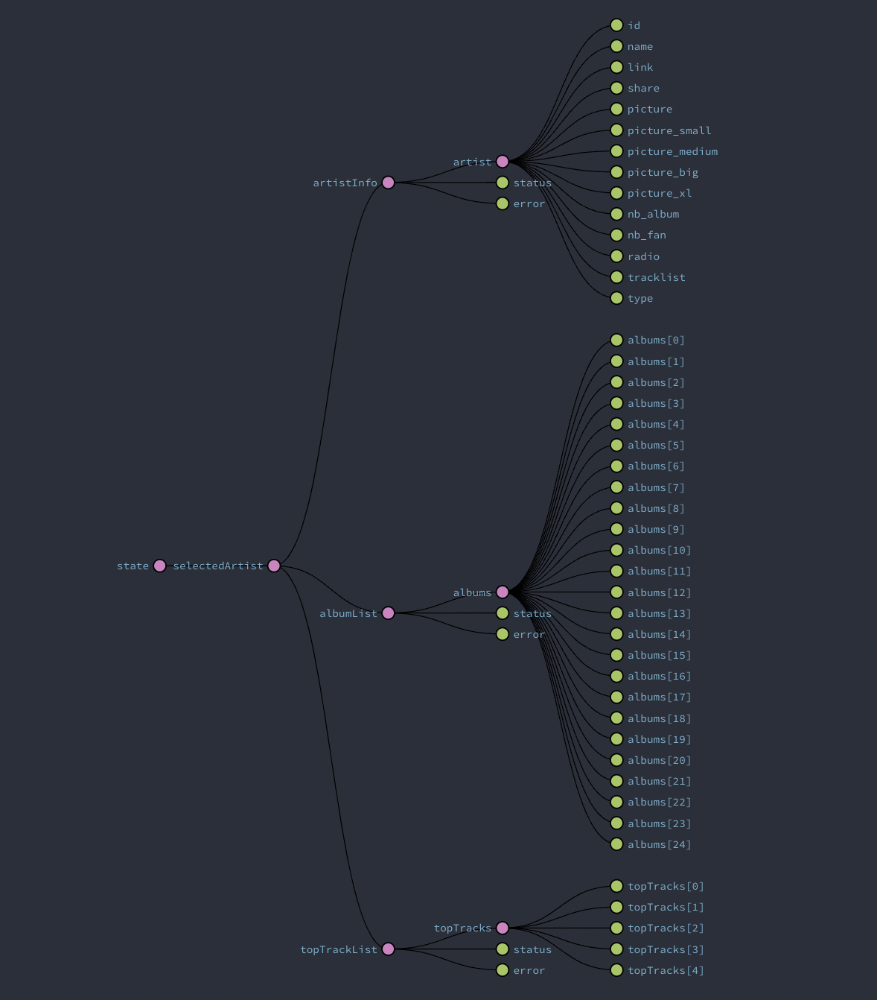
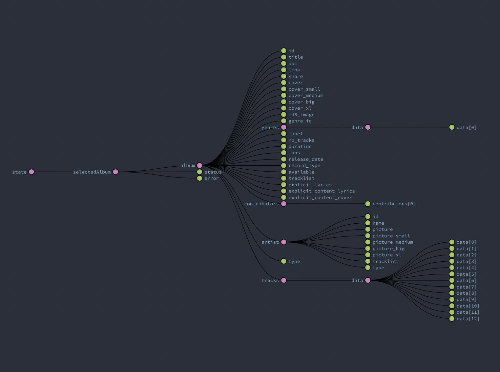
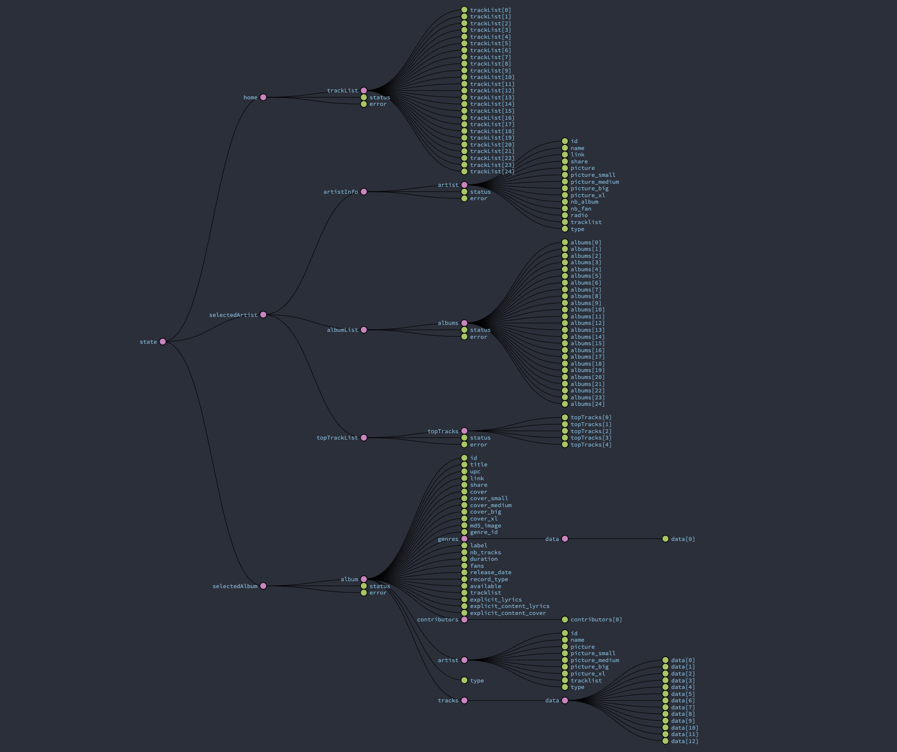
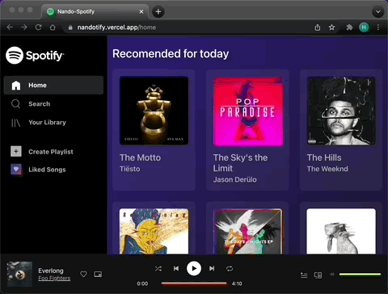
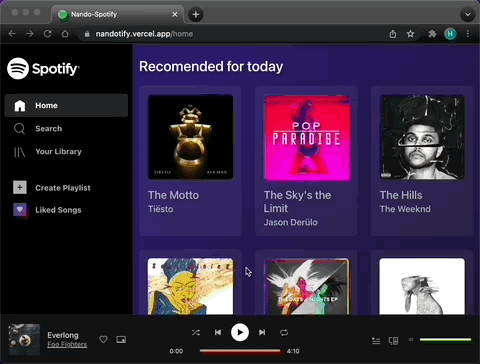
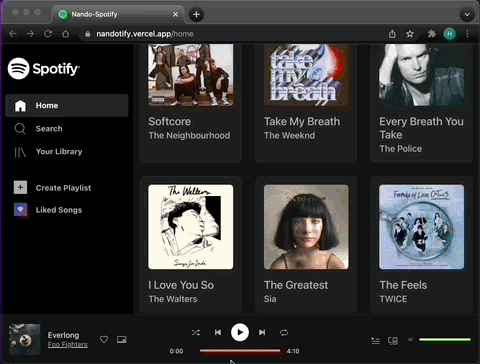

<div id="top"></div>

<!-- PROJECT LOGO -->
<br />
<div align="center">
  <a href="https://github.com/Nando-C/StriveM7D5">
    
  </a>

<h3 align="center">Spotify Clone — Front-End</h3>

  <p align="center">
    A project that clones Spotify, developed during Strive School's Full Stack program!
    <br />
    <br />
    <a href="https://nandotify.vercel.app/">View Demo</a>
    <!-- ·
    <a href="https://github.com/Nando-C/Buildweek2/issues">Report Bug</a> -->
  </p>
</div>

<!-- TABLE OF CONTENTS -->
<details>
  <summary>Table of Contents</summary>
  <ol>
    <li>
      <a href="#about-the-project">About The Project</a>
      <ul>
        <li><a href="#built-with">Built With</a></li>
        <li><a href="#recently-modernized-2026">Recently modernized (2026)</a></li>
        <li><a href="#redux-store">Redux Store</a>
      </ul>
    </li>
    <li><a href="#getting-started">Getting Started</a></li>
    <li><a href="#app-use">App Use</a>
     <ul>
        <li><a href="#home">Home</a></li>
        <li><a href="#search">Search</a></li>
      </ul>
    </li>
    <li><a href="#player">Player</a></li>
    <li><a href="#tests">Tests</a></li>
    <li><a href="#contact">Contact</a></li>
  </ol>
</details>

<!-- ABOUT THE PROJECT -->

## About The Project



A Spotify clone project to put in practise our Front-End skills, as part of the Full Stack Master Camp at Strive School. This was my first real world project, started during the first modules of the program, but then I decided to create this new repo and built it again from scratch, as I have a much better understanding of the technologies and code practises.

All the information is retrieved from the [Deezer API](https://developers.deezer.com/api), through a small backend proxy. This repository is the front-end only.

<p align="right">(<a href="#top">back to top</a>)</p>

### Built With

- [React 19](https://react.dev/)
- [Redux Toolkit 2](https://redux-toolkit.js.org/) with [React Redux 9](https://react-redux.js.org/)
- [React Router 7](https://reactrouter.com/)
- [React Bootstrap](https://react-bootstrap.github.io/) on [Bootstrap 5.3](https://getbootstrap.com)
- [Axios](https://axios-http.com/)
- [Vite 8](https://vite.dev/) for the dev server and the build
- [Vitest](https://vitest.dev/), [Testing Library](https://testing-library.com/) and [MSW](https://mswjs.io/) for the tests
- [ESLint 9](https://eslint.org/)

<p align="right">(<a href="#top">back to top</a>)</p>

### Recently modernized (2026)

The project was written in 2021–22 on Create React App. In November 2026 it was brought up to date without changing how it looks:

- **Build tool:** Create React App (react-scripts 5) → Vite 8.
- **Libraries:** React 17 → 19, Redux Toolkit 1 → 2, React Redux 7 → 9, React Router 6 → 7, Axios 0.26 → 1.x, Bootstrap 5.1 → 5.3.
- **Security:** `npm audit` went from 96 reported vulnerabilities (9 critical) to 0, as of 14 November 2026.
- **Tests:** from none that passed to 28, covering the home page, search and playback.
- **Linting:** an ESLint flat config, with `npm run lint` at zero errors.
- **Fixes along the way:** the search page now waits for a pause in typing before it sends a request, cancels requests that have been superseded, and shows an error message if the request fails; the play button on the artist page works on a fresh page load; the progress bar fills correctly for the first track played; and the player no longer keeps extra progress loops running after a track change.

<p align="right">(<a href="#top">back to top</a>)</p>

### Redux Store

Part of the objectives for this project was to consolidate my knowledge using Redux and Redux Tool Kit. So I created three Redux slices to handle the data shown on each page, and later a fourth one, `currentSong`, which holds the state of the audio player (the loaded track, whether it is playing, its duration, the current time and the volume).

- Home

    

- Artist

    

- Album

    

- A full picture of the state

    

I did not see the point of including the search page information in the redux store, so this is managed on the component's local state.

<p align="right">(<a href="#top">back to top</a>)</p>

<!-- GETTING STARTED -->

## Getting Started

You need [Node.js](https://nodejs.org/) 20.19 or newer (or 22.12 or newer).

1. Install the dependencies:

   ```sh
   npm install
   ```

2. Copy `.env.example` to `.env` and set `VITE_BACKEND_URL` to the base URL of a backend that proxies the Deezer API. The app calls `/search`, `/artist/:id`, `/artist/:id/top`, `/artist/:id/albums` and `/album/:id` on it.

   ```sh
   cp .env.example .env
   ```

3. Start the dev server on http://localhost:3000:

   ```sh
   npm run dev
   ```

| Command           | What it does                                   |
| ----------------- | ---------------------------------------------- |
| `npm run dev`     | Dev server (`npm start` does the same)         |
| `npm run build`   | Production build into `dist/`                  |
| `npm run preview` | Serves the production build locally            |
| `npm test`        | Runs the test suite once                       |
| `npm run lint`    | Runs ESLint over `src/`                        |

The live demo is deployed on Vercel. `vercel.json` sets the build output and the rewrite that makes links such as `/Artist/412` work when opened directly; `VITE_BACKEND_URL` has to be set in the Vercel project as well, because Vite reads it at build time.

<p align="right">(<a href="#top">back to top</a>)</p>

<!-- USAGE EXAMPLES -->

## App Use

The work flow of this application is similar to the real spotify. However, not all features have been implemented, yet.

### Home

- Home is the landing page, you will start from here, where you have some recomendations of the day.
- By clicking on the album cover or the song title, you will be directed to the album page.

    

- Otherwise, clicking on the artist name will take you to the artist page.

    

<p align="right">(<a href="#top">back to top</a>)</p>

### Search

- Go to the search page by clicking on the search option on the navigation bar.
- Here you start with a selection of tracks to explore.
- To perform a search, start typing the name of your favorite song or artist on the search box. The results update once you pause typing.

    

- Once you have found what you are looking for, access the content in the same way as in the home page.

<p align="right">(<a href="#top">back to top</a>)</p>

<!-- PLAYER -->

## Player

You can play a 30-second preview of any track, which is what the Deezer API provides.

- Press the play button on a card on the home or search page, on a row of an album or of an artist's popular tracks, or the large green button on an album or artist page.
- The bar at the bottom shows the track that is loaded, with links to its album and its artist, and keeps playing while you move between pages.
- From the bar you can play and pause, drag the progress bar to seek, skip five seconds back or forward with the two arrow buttons, and change the volume.
- Choosing a different track while one is playing switches to it straight away.

The shuffle, repeat, like, follow and playlist controls are part of the layout but do not do anything yet, and the Your Library page is a placeholder.

<p align="right">(<a href="#top">back to top</a>)</p>

<!-- TESTS -->

## Tests

```sh
npm test
```

The tests are in `src/tests/` and run in jsdom with Vitest and Testing Library. They never call the real API: MSW answers every request, and a request without a handler fails the test. Since jsdom cannot play audio, the player tests replace the audio element's `play` and `pause` and check which track's file was playing, not only what the Redux state says.

<p align="right">(<a href="#top">back to top</a>)</p>

<!-- CONTACT -->

## Contact

[@Nando](https://hernando-crespo.vercel.app/) - Get in touch and let me know what do you think of this project! 😉

<p align="right">(<a href="#top">back to top</a>)</p>
